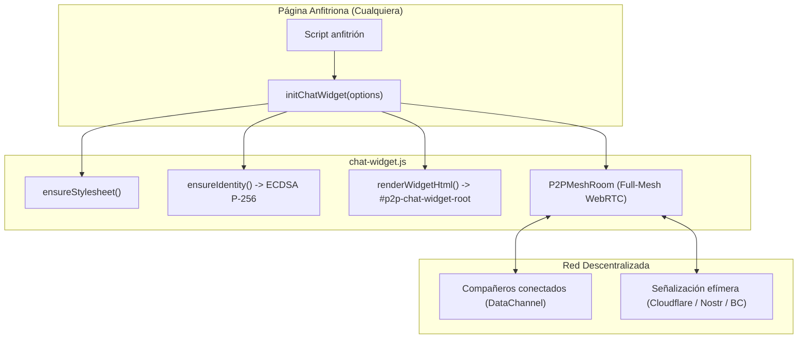

# 💬 Widget Flotante de Chat P2P · Documentación Técnica

El **Widget Flotante de Chat P2P** (`chat-widget.js`) es un componente autónomo en Vanilla JavaScript que permite incrustar en cualquier página web un botón flotante (FAB) y una ventana de chat directo entre alumnos mediante **WebRTC DataChannels**, aprovechando al 100% la infraestructura criptográfica y de red del proyecto `h-cfgs-3d` sin acoplarse al HTML de la página anfitriona.

---

## 🚀 Inicio Rápido

### Invocación básica desde un script
Para inicializar el widget en cualquier página web:

```html
<script type="module">
  import { initChatWidget } from '/src/chat/chat-widget.js';

  // Inicialización básica
  const chat = await initChatWidget();
</script>
```

El widget se auto-inyectará en la esquina inferior derecha y cargará automáticamente su hoja de estilos `/css/chat-widget.css`.

---

## ⚙️ Opciones de Configuración

La función `initChatWidget(options)` acepta un objeto de configuración con las siguientes propiedades:

| Propiedad | Tipo | Valor por Defecto | Descripción |
| :--- | :---: | :---: | :--- |
| `defaultRoom` | `string` | `'general'` | Identificador de la sala inicial (`'general'`, `'dudas-3d'`, `'entregas-aules'`, `'ocio-gaming'`). |
| `autoOpen` | `boolean` | `false` | Si es `true`, despliega la ventana flotante automáticamente nada más cargar. |
| `soundEnabled` | `boolean` | `true` | Emite un tono sutil (Web Audio API) al recibir un mensaje si la ventana está minimizada. |
| `cssPath` | `string` | `'/css/chat-widget.css'` | Ruta alternativa a la hoja de estilos para despliegues en subcarpetas. |

### Ejemplo con opciones avanzadas:
```javascript
import { initChatWidget } from '/src/chat/chat-widget.js';

const chat = await initChatWidget({
  defaultRoom: 'dudas-3d',
  autoOpen: false,
  soundEnabled: true,
  cssPath: '/css/chat-widget.css'
});
```

---

## 🕹️ API de Control Imperativo

`initChatWidget()` devuelve una promesa que resuelve en un objeto de control (también disponible globalmente en `window.__p2pChatWidget`):

```javascript
// Abrir y cerrar la ventana flotante
chat.open();
chat.close();
chat.toggle();

// Consultar estado
console.log('¿Está abierto?:', chat.isOpen());
console.log('Sala actual:', chat.getCurrentRoom());

// Cambiar de sala P2P en caliente
chat.switchRoom('entregas-aules');

// Destruir el widget (desconecta WebRTC, remueve eventos y elimina el DOM)
chat.destroy();
```

---

## 🏗️ Arquitectura y Funcionamiento Interno



1. **Auto-inyección No Intrusiva:** Si `#p2p-chat-widget-root` no existe en `document.body`, el widget lo genera automáticamente con `pointer-events: none` para no bloquear los clics del resto de la página.
2. **Identidad Criptográfica ECDSA P-256:** Lee la clave de `localStorage` mediante `storage.js`. Si no existe, genera una nueva con `crypto.js` y asigna un apodo automático derivado de la huella SHA-256 (`0x...`).
3. **Señalización Multi-Canal:** Conecta con `P2PMeshRoom`, capaz de negociar pares mediante:
   - `BroadcastChannel` local (pestañas en el mismo navegador sin red).
   - WebSocket / HTTP en `/api/chat-signal` (Cloudflare Pages Functions).
   - Relays descentralizados de Nostr.
4. **Transferencia P2P de Archivos (FileDrop):** Permite arrastrar o seleccionar archivos de texturas, modelos `.obj`/`.blend` o capturas de pantalla, transfiriéndolos en trozos de 16 KB con certificado de autoría firmado digitalmente.
5. **Enlace a Pantalla Completa:** La cabecera incluye un botón `[ ↗ ]` que abre [`chat.html#<sala>`](file:///d:/WorkSpace/GIT/h_cfgs_3d-main/chat.html) en una nueva pestaña, compartiendo la misma identidad y el historial de mensajes.

---

## 🎨 Personalización de Estilos y Temas

Los estilos en [`css/chat-widget.css`](file:///d:/WorkSpace/GIT/h_cfgs_3d-main/css/chat-widget.css) están 100% aislados bajo el selector `#p2p-chat-widget-root`. Heredan automáticamente las variables del tema de la aplicación con fallbacks seguros:

```css
#p2p-chat-widget-root {
  --cw-bg: var(--bg, light-dark(#f4f6f9, #0a0e16));
  --cw-surface: var(--surface, light-dark(#ffffff, #111827));
  --cw-surface-2: var(--surface-2, light-dark(#eceff4, #0d1421));
  --cw-line: var(--line, light-dark(#d3d9e2, #222d40));
  --cw-text: var(--text, light-dark(#101828, #eef2f8));
  --cw-muted: var(--muted, light-dark(#5a6577, #94a1b5));
  --cw-accent: var(--accent, light-dark(#0284c7, #38bdf8));
}
```

En dispositivos móviles (`@media (max-width: 600px)`), la ventana flotante se transforma automáticamente en un **Bottom Sheet** táctil fijado a la parte inferior de la pantalla.

---

## 🧪 Pruebas Unitarias

Para ejecutar la suite de pruebas unitarias automatizadas con Node.js:

```bash
node --test tests/chat-widget.test.js
```

La suite cubre:
- Formateo de bytes y tamaños de archivo (`formatBytes`).
- Generación y marcado WAI-ARIA del HTML (`renderWidgetHtml`).
- Preservación de salas seleccionadas y listas oficiales.
- Validación de entorno con control de excepciones fuera de navegadores DOM.
